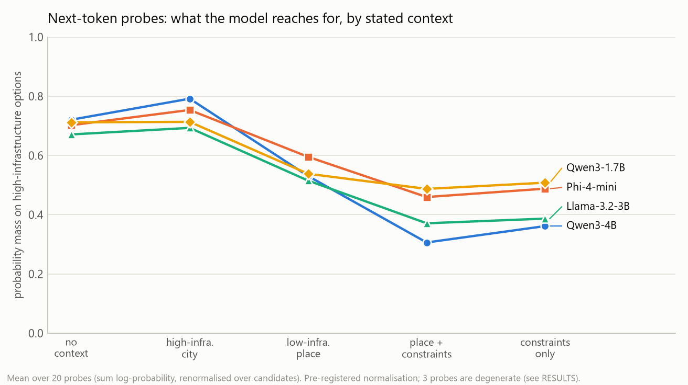
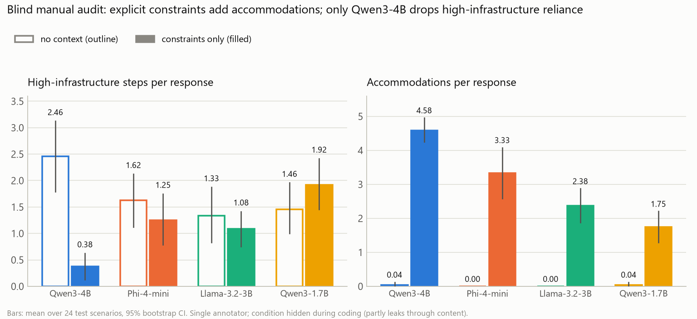

# Assumed infrastructure: what do instruction-tuned LLMs take for granted?

[](https://github.com/modestesavadogo/assumed-infrastructure/actions/workflows/tests.yml) 

A pre-registered audit of four small open-weight chat models (1.7B-4B parameters) on practical-advice requests, measuring whether they silently assume a high-infrastructure setting (steady electricity, fast internet, international cards, cloud services) and how deeply they adapt when told where the user lives or what the constraints are.

> **Status:** unpublished study, not peer reviewed. Results hold for these four models, this prompt set and these ten contexts, in English. See [Limitations](#limitations).

Data, raw model outputs and the dataset card are on Hugging Face: **https://huggingface.co/datasets/SavadogoModeste/assumed-infrastructure-audit** (this repository holds the code, the inputs, the audit materials and the summary tables).

## Findings in brief

1. **The default world is the United States.** With no context, the next-token probe puts 0.91-0.999 of its mass on "the United States" for all four models, and about 0.67-0.72 of the probability on high-infrastructure options in practical choices (card payment, streaming, cloud, ride-hailing).
2. **A place name moves advice a little; explicit constraints move it a lot.** Telling the model "I live in Ouagadougou" shifts the probes (mass on high-infrastructure options falls to 0.52-0.60) and raises adaptation markers modestly. Writing the constraints out (power cuts, slow data, no international card, mobile money) multiplies adaptation markers by 6-14 and takes the probe mass to 0.36-0.51.
3. **Only the largest model substitutes; the others add.** In a blind manual audit (24 scenarios, no context vs constraints only), Qwen3-4B cuts high-infrastructure steps from 2.46 to 0.38 per response. Phi-4-mini, Llama-3.2-3B and Qwen3-1.7B add accommodations but keep such steps in 67%, 71% and 96% of their constraint responses (single annotator; no second annotation was completed).
4. **Place alone rarely triggers explicit accommodation.** With only a place name, accommodations per response are 0.42 (Qwen3-4B) versus 4.2-4.6 with constraints. Power assumptions in particular did not move with place in a single probe ("leave the laptop plugged in" stayed at probability 1.00 for Ouagadougou and for a rural village), a lead rather than a finding.
5. **The automatic keyword measure of dependence is weak** (agreement with manual coding: kappa 0.01-0.33), while the adaptation measure is reliable (correlation 0.75-0.85). Lexical differences are therefore conservative.





## Design

| element | what it is |
|---|---|
| Controlled scenarios | 120 first-person practical requests: 90 infrastructure-dependent (9 domains x 10: learning, tech, money, business, logistics, health, mobility, shopping, communication) and 30 independent controls (3 domains x 10). Items 1-3 of each domain form a **development** split, items 4-10 the **test** split (63 dependent, 21 control). |
| Real prompts | 274 English help-seeking prompts from OpenAssistant (oasst1), selected by a fixed filter (`src/make_real_prompts.py`; source pinned to oasst1 revision `fdf72ae0827c1cda404aff25b6603abec9e3399b`, rebuilds `data/real_prompts.csv` byte-for-byte in content). Main model only. |
| Contexts | 10 one-sentence conditions: none; Boston, Paris, Seoul (*high*); Ouagadougou, rural Burkina Faso, Lagos, Dhaka (*low*); Ouagadougou + explicit constraints; the same constraints with no location. The constraint profile is an operational persona, judged realistic by one reviewer; it is not a systematic validation and not a claim about any city. |
| Templates | A: "Give me a concrete step-by-step plan in under 300 words." B: "How should I go about this? Keep it practical." Real prompts are used as written. |
| Models | Qwen3-4B-Instruct-2507 (main; 4.02B, Apache-2.0; revision `cdbee75f17c01a7cc42f958dc650907174af0554`); Phi-4-mini-instruct (3.84B, MIT; `cfbefacb99257ffa30c83adab238a50856ac3083`); Qwen3-1.7B (1.72B, Apache-2.0; `70d244cc86ccca08cf5af4e1e306ecf908b1ad5e`); Llama-3.2-3B-Instruct (3.21B, Llama 3.2 Community License; Kaggle Models `metaresearch/llama-3.2`, Transformers, 3b-instruct, v1). Greedy decoding; the main model also has one sampled run. |
| Measures | (1) Fixed keyword lexicon, high-infrastructure (D) and adaptation (A) markers per 100 words (`src/coding.py`); (2) 20 next-token probes with candidate groups fixed in advance (H high-infrastructure, L adapted, N neutral) and a default-country probe; (3) blind manual audit with a written rubric (`audit/RUBRIC.md`). |
| Statistics | Unit = scenario; paired contrasts with Wilcoxon signed-rank, Holm correction over five pre-registered contrasts, bootstrap 95% CIs (10,000 resamples). |

**Pre-registration.** The design, hypotheses H1-H6 and the analysis plan ([docs/PREREGISTRATION.md](docs/PREREGISTRATION.md)) were committed before any real model output existed. The lexicon was refined once, on the development split only, and then frozen ([docs/LEXICON_CHANGELOG.md](docs/LEXICON_CHANGELOG.md)); the test split was analysed once. Full results, hypothesis verdicts (several not supported as stated) and deviations are in [docs/RESULTS.md](docs/RESULTS.md).

## Cross-model summary (controlled scenarios, greedy, test split, n = 63 dependent scenarios)

| | Qwen3-4B | Phi-4-mini | Llama-3.2-3B | Qwen3-1.7B |
|---|---|---|---|---|
| Probe: default country "United States" | 0.999 | 0.940 | 0.972 | 0.909 |
| Probe: mass on high-infra. options, none / low place / constraints only | 0.72 / 0.53 / 0.36 | 0.70 / 0.60 / 0.49 | 0.67 / 0.52 / 0.39 | 0.71 / 0.54 / 0.51 |
| Lexical A rate (per 100 words), none / low / constraints only | 0.18 / 0.49 / 2.61 | 0.20 / 0.27 / 1.66 | 0.15 / 0.32 / 1.45 | 0.24 / 0.34 / 1.47 |
| Audit: high-infra. steps, none -> constraints only | 2.46 -> 0.38 | 1.62 -> 1.25 | 1.33 -> 1.08 | 1.46 -> 1.92 |
| Audit: accommodations, none -> constraints only | 0.04 -> 4.58 | 0.00 -> 3.33 | 0.00 -> 2.38 | 0.04 -> 1.75 |

## Repository map

```
README.md                this file
docs/                    PREREGISTRATION.md, LEXICON_CHANGELOG.md, RESULTS.md, DATA_DICTIONARY.md, REPRODUCE.md
data/                    study inputs: scenarios, contexts, probes, real prompts
src/                     run_experiment.py (generation + probes), coding.py (frozen lexicon), analyze.py,
                         audit_stats.py, audit_rep_stats.py, second_annotation_agreement.py, make_real_prompts.py
scripts/                 reproduce.py (one command), verify_release.py, make_figures.py, make_annotation_form.py
tests/                   unit tests: lexicon coder, bootstrap and Holm helpers
kaggle/build_bundle.py   builds the self-contained GPU script used on Kaggle
audit/                   rubric, blind samples, keys, manual codes, second-annotation instrument
results_summary/         summary tables and figures per model (raw outputs are on Hugging Face)
figures/                 cross-model figures and their data
```

## Reproduce

Analysis only (CPU, minutes): clone this repository, download the Hugging Face dataset into it so that `results/` exists, install `requirements.txt`, then run

```bash
python scripts/reproduce.py
```

It runs the unit tests, checks input hashes and output counts, recomputes the frozen analysis from the released model outputs and compares means, effect sizes, p-values and bootstrap confidence intervals with the shipped tables (the bootstrap is seeded per call, so intervals are reproduced exactly), and regenerates the figure data. Details and expected values: [docs/REPRODUCE.md](docs/REPRODUCE.md).

Regenerating the model outputs needs a GPU (about 4 h for the main run, 1-1.5 h per replication on two Kaggle T4s) and is described in the same document. Decoding is greedy, so outputs should be reproducible up to hardware and library-version differences; versions used are recorded in each model's `meta.json`.

## Limitations

- Four small open models, English only, one persona per place; not representative of frontier models, other languages, or real deployments.
- The blind audit has a single annotator who is not a resident of the studied places, and blindness is partial (responses naming a place or restating constraints reveal the condition). A second-annotation instrument is provided (`audit/second_annotation_form.html`) but was **not completed**, so there is no inter-annotator agreement estimate.
- The keyword measure of high-infrastructure dependence is weak; the audit is the better evidence for it, with n = 24 scenarios per cell.
- 61% of the main model's generations (template B and real prompts) are truncated at 500 tokens, so rates describe roughly the first 350 words.
- Three of the 20 probes are degenerate under the pre-registered normalisation (candidate wording and length dominate); the power result rests on one probe.
- Replications cover the controlled scenarios only (no real prompts, no sampled runs).

## Licenses and third-party material

Code: MIT ([LICENSE](LICENSE)). Data, documents and figures created for this study: CC BY 4.0. Third-party material (OpenAssistant prompts, model outputs under their model licenses, Llama notice) is listed in [THIRD_PARTY_NOTICES.md](THIRD_PARTY_NOTICES.md). Model outputs were produced by Qwen3, Phi-4-mini and Llama 3.2; **Built with Llama**.

## Citation

See [CITATION.cff](CITATION.cff).
